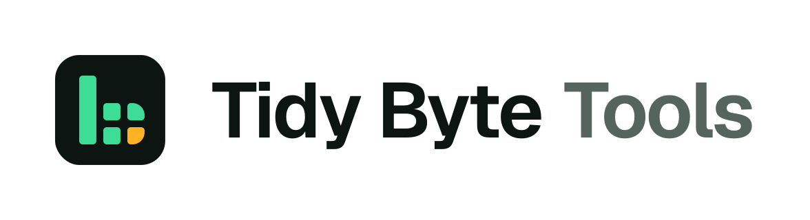

<p>
  <a href="https://github.com/tidybytetools">
    <picture>
      <source media="(prefers-color-scheme: dark)" srcset="https://raw.githubusercontent.com/tidybytetools/hash-lite/main/assets/tidybytetools-lockup-dark.png">
      
    </picture>
  </a>
</p>

# hash-lite

[](https://github.com/tidybytetools/hash-lite/blob/main/LICENSE)
[](https://www.python.org/)
[](#use-it-from-claude-desktop-or-cursor-mcp)
[](https://github.com/tidybytetools/hash-lite/actions/workflows/tests.yml)

Free tool that hashes text or local files with SHA-256, SHA-1, MD5, and optional SHA-512. You get hex and Base64.

Need it at scale or from an AI agent? Use the Apify version: **[hash-checksum on Apify](https://apify.com/tidybytetools/hash-checksum)**

Plain code, not AI, so the same input always gives the same hashes. Runs on your own computer. MIT license. Works with Python 3.10 and newer, on Windows, Mac and Linux.

## Links

- **[Apify (no-install cloud version)](https://apify.com/tidybytetools/hash-checksum)** — pay only for what you use, about $0.001 per unique input. All selected hashes are included. Repeats in the same run are free. (This listing goes public this week.)

<!-- mcp-name: io.github.tidybytetools/hash-lite -->

## Before and after

Before (text):

```
hello world
```

After (SHA-256, SHA-1, and MD5, which are on by default):

```
sha256: b94d27b9934d3e08a52e52d7da7dabfac484efe37a5380ee9088f7ace2efcde9
sha1:   2aae6c35c94fcfb415dbe95f408b9ce91ee846ed
md5:    5eb63bbbe01eeed093cb22bb8f5acdc3
```

Text is hashed as UTF-8 bytes. Local files are hashed as the raw file bytes.

## Install

```
pip install git+https://github.com/tidybytetools/hash-lite
```

Or use pipx, which keeps it in its own space:

```
pipx install git+https://github.com/tidybytetools/hash-lite
```

Or just download `hash_lite.py` and run it with `python3`. That one file uses only Python's standard library. (Installing with pip also adds the `mcp` package, which the MCP server needs.)

## Use it

```
printf 'hello world' | hash-lite
hash-lite photo.png
hash-lite photo.png --algorithms sha256,sha512
hash-lite photo.png --no-base64
printf 'hello world' | hash-lite --json     # {"ok": true, "bytes": 11, "sha256": "...", ...}
```

If you pass a file, the raw bytes are hashed. If you pipe text, it is hashed as UTF-8. `--algorithms` is a comma-separated list from `sha256`, `sha1`, `md5`, and `sha512`. The default is `sha256,sha1,md5`.

From Python:

```python
from hash_lite import hash_text
hash_text("hello world")["sha256"]  # 'b94d27b9934d3e08a52e52d7da7dabfac484efe37a5380ee9088f7ace2efcde9'
```

When you run it in a terminal it prints one short line about the Apify version to stderr after the result. It never goes into your JSON output, it only shows when you are looking at a terminal, and `--quiet` turns it off.

## Known limits

- **MD5 and SHA-1 are not safe for new security work.** They are included because people still need them for checks. Prefer SHA-256 or SHA-512 when you can.
- **Local files only.** This free tool does not fetch file links from the internet. The Apify version does.
- **5 MB cap in the MCP file tool.** The command line will read a larger local file, but very large jobs are a better fit for Apify.
- **It does not look the hash up** in a malware list or a password list.

## Lite vs Apify

| | lite (free, this repo) | [hash-checksum on Apify](https://apify.com/tidybytetools/hash-checksum) |
|---|---|---|
| Hash text or files | yes, on your computer | yes, in the cloud |
| SHA-256, SHA-1, MD5, SHA-512 | yes | yes |
| Hex and Base64 | yes | yes |
| Fetch file links | no | yes |
| Many items in one run | you can loop on your own | yes, and repeats in the same run are free |
| MCP server for local AI apps | yes | use Apify MCP for the cloud tool |
| Price | free | $0.001 per unique input. All selected hashes are included |

## Use it from Claude Desktop or Cursor (MCP)

There is a small free MCP server built in. It gives your AI app two tools. Both only read. They never write or change files, and they never use the internet. It needs [uv](https://docs.astral.sh/uv/).

Run it by hand to check it starts (it waits quietly for an app to talk to it):

```
uvx --from git+https://github.com/tidybytetools/hash-lite hash-lite mcp
```

Claude Desktop (`claude_desktop_config.json`) or Cursor (`~/.cursor/mcp.json`):

```json
{
  "mcpServers": {
    "hash-lite": {
      "command": "uvx",
      "args": ["--from", "git+https://github.com/tidybytetools/hash-lite", "hash-lite", "mcp"]
    }
  }
}
```

`uvx --from git+https://github.com/tidybytetools/hash-lite hash-lite-mcp` starts the same server.

Tools:

- `hash_text(text, algorithms=null, include_base64=true)`: hash UTF-8 text in the chat.
- `hash_file(path, algorithms=null, include_base64=true)`: hash the raw bytes of a local file, up to 5 MB.

`algorithms` is a list from `sha256`, `sha1`, `md5`, `sha512`. The default is `sha256`, `sha1`, and `md5`. Both tools return the hex (and Base64, unless you turn that off) for each selected algorithm.

## For AI agents

- **Use when:** you need a SHA-256, SHA-1, MD5 or SHA-512 checksum of text or a local file.
- **Don't use when:** you need to fetch a file from a URL, look a hash up in a malware list, or the file is bigger than 5 MB in MCP. Use the Apify version for URL and large-file jobs.
- **Input:** text on stdin (UTF-8) or a file path (raw bytes). Optional `--algorithms sha256,sha1,md5,sha512` and `--no-base64`.
- **MCP:** `uvx --from git+https://github.com/tidybytetools/hash-lite hash-lite mcp` gives two read-only tools, `hash_text` and `hash_file`.
- **Output:** with `--json`, one object: `{"ok": true, "bytes": 11, "sha256": "...", ...}`. On error `ok` is false. Exit code 0 ok, 1 error.
- Hint lines go to stderr only, and only in a terminal, so stdout is always clean JSON. See also [`llms.txt`](https://github.com/tidybytetools/hash-lite/blob/main/llms.txt).

## Tests

```
pip install "mcp>=1.10,<2"
python3 -m unittest discover tests
```

The MCP tests are skipped if `mcp` is not installed.

## FAQ

**What input does it take?**
Text on stdin (hashed as UTF-8), or a local file (hashed as raw bytes).

**Do my files leave my computer?**
No. The tool runs on your computer and never uses the internet.

**Is MD5 or SHA-1 safe to use for security?**
No, not for new security work. Prefer SHA-256 or SHA-512. MD5 and SHA-1 are still useful for simple checks.

**How is this different from the Apify version?**
The Apify version runs in the cloud, can fetch file links, and can process many items in one run. This lite tool is free and local.

**Does it work with AI apps?**
Yes. It includes a free MCP server. No API key.

## License

MIT. See `LICENSE`.
